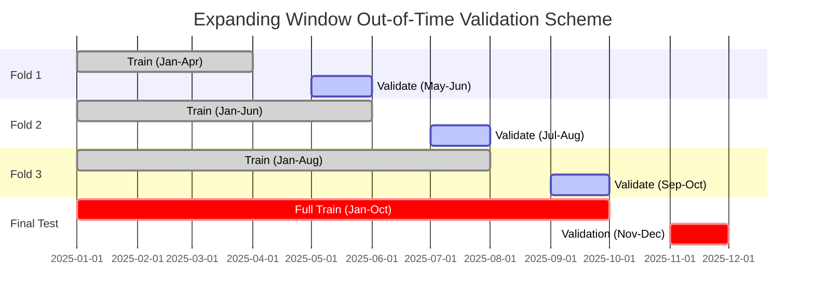

# Spotter Freight Rate Prediction: Comprehensive Methodology & Technical Plan

## 1. Executive Summary & Problem Formulation

### 1.1 Business & Domain Context
In the freight logistics and brokerage ecosystem, pricing accuracy directly dictates operational margin and carrier compliance. Spotter's challenge requires predicting the spot market load rate (`posted_rate`) for freight transactions across the United States. 

- **Underpricing** leads to rejected tenders, service failures, or negative margins when carriers reject low offers.
- **Overpricing** leads to uncompetitive quotes and lost freight volume to competitor brokers.
- **Goal**: Develop a robust, generalizable, and production-grade Machine Learning pipeline that predicts continuous spot rates accurately on future unseen freight loads (`validation.csv`) and simulates daily rate fluctuations on a fixed lane in December 2025 (`december-chart-inputs.csv`).

### 1.2 Mathematical Formulation
We frame this as a supervised regression task on tabular and spatio-temporal data:
$$\hat{y} = f_{\theta}(\mathbf{X}_{\text{spatial}}, \mathbf{X}_{\text{shipment}}, \mathbf{X}_{\text{temporal}}, \mathbf{X}_{\text{market}})$$
where:
- Target $y \in \mathbb{R}^+$ is `posted_rate` (strictly positive continuous dollar amount).
- Alternatively, rate per mile $\hat{r}_{\text{mile}} = \frac{\hat{y}}{\text{distance}}$ or log-target $\ln(y)$ can be modeled to enforce positive predictions and stabilize variance across disparate haul lengths.

---

## 2. Dataset Architecture & Exploratory Insights

From exploratory analysis across the provided files:

| Dataset | File | Records | Features | Date Range | Primary Role |
| :--- | :--- | :--- | :--- | :--- | :--- |
| **Development** | `train-test.csv` | 48,000 | 14 | Jan 1, 2025 – Oct 31, 2025 | Model development, feature extraction, cross-validation |
| **Out-of-Time Validation** | `validation.csv` | 12,000 | 13 | Nov 1, 2025 – Dec 31, 2025 | Final scoring evaluation |
| **December Scenario** | `december-chart-inputs.csv` | 31 | 7 | Dec 1, 2025 – Dec 31, 2025 | Fixed lane (Lexington $\to$ Fort Wayne) daily time-series chart |
| **Submission Output** | `validation_predictions.csv` | 12,000 | 2 (`load_id, predicted_rate`) | N/A | Target deliverable verified by `score.py` |

### 2.1 Feature Taxonomy
1. **Identifiers & Origin-Destination**: `load_id`, `pickup`, `delivery` (64 unique geographic markets).
2. **Geospatial Coordinates**: `pickup_lat`, `pickup_lon`, `delivery_lat`, `delivery_lon`.
3. **Shipment Specifications**: `distance` (miles), `equipment` (`Dry Van`: 56.7%, `Reefer`: 25.1%, `Flatbed`: 18.2%), `weight` (lbs).
4. **Temporal Coordinates**: `date` (daily granularity).
5. **Market Signals**: `market_index` (macro market tightness index), `quote_signal` (instantaneous market quote multiplier).
6. **Target**: `posted_rate` (mean: $2,373.98, median: $2,030.76, min: $57.22, max: $25,533.00).

---

## 3. Data Quality Issues & Mitigation Strategy

Our pre-flight audit detected specific data quality nuances that must be handled systematically:

```
Data Quality Audit:
├── Missing Values:
│   ├── weight: 300 missing in dev (0.63%), 165 missing in validation (1.38%)
│   └── market_index: 374 missing in dev (0.78%), 249 missing in validation (2.08%)
├── Categorical Integrity:
│   └── equipment: Exactly 3 clean categories (Dry Van, Reefer, Flatbed)
├── Coordinate Consistency:
│   └── All 64 cities map 1-to-1 to fixed centroid lat/lon coordinates
└── Target Sanity:
    └── posted_rate: Strictly positive; minimum value $57.22 (no zeros/negatives)
```

### Mitigation Actions:
1. **Missing Weight Imputation**:
   - Rather than simple global mean/median, compute conditional median weight grouped by `equipment` type (or equipment + mileage bucket), since flatbeds and refrigerated reefers possess distinct cargo density distributions.
   - Create a binary indicator column `weight_is_missing` to allow tree models to capture structural missingness patterns.
2. **Missing Market Index Imputation**:
   - `market_index` represents macro spot market pricing tightness on that date.
   - Apply forward-fill / backward-fill on daily mean values, falling back to local rolling 7-day averages.
   - Add a binary indicator `market_index_is_missing`.
3. **Target Positivity Assurance**:
   - Predict $\ln(\text{posted\_rate})$ or use exponentiated outputs to guarantee $\hat{y} > 0$, satisfying the strict validation constraint in `score.py`.

---

## 4. Rigorous Validation Strategy (Anti-Leakage Protocol)

> [!IMPORTANT]
> **Why Random $K$-Fold Shuffling Fails in This Problem:**
> `train-test.csv` covers **January 1 to October 31, 2025**, while `validation.csv` covers **November 1 to December 31, 2025**. Randomly shuffling across time would cause temporal data leakage (e.g., training on October 25 to predict October 12), inflating validation metrics unrealistically. The model would learn contemporaneous market trends rather than true forecasting capabilities.

### 4.1 Primary Validation: Out-of-Time (OOT) Holdout Split
- **Train Window**: January 1, 2025 – August 31, 2025 (8 months, ~38,400 loads).
- **Validation Window**: September 1, 2025 – October 31, 2025 (2 months, ~9,600 loads).
- **Rationale**: The 2-month validation horizon directly replicates the 2-month validation task (Nov–Dec 2025).

### 4.2 Secondary Validation: Expanding-Window Purged Cross-Validation
To test model stability across multiple seasonal transitions:
- **Fold 1**: Train Jan–Apr $\to$ Validate May–Jun
- **Fold 2**: Train Jan–Jun $\to$ Validate Jul–Aug
- **Fold 3**: Train Jan–Aug $\to$ Validate Sep–Oct



---

## 5. Feature Engineering Pipeline

Freight rates are driven by physics (distance, weight), equipment constraints, network geometry (backhaul vs. headhaul), and calendar seasonality.

### 5.1 Geospatial & Lane Engineering
- **Haversine Distance**: Great-circle distance between pickup and delivery coordinates:
  $$d_{\text{haversine}} = 2 R \arcsin \sqrt{\sin^2\left(\frac{\Delta\phi}{2}\right) + \cos\phi_1\cos\phi_2\sin^2\left(\frac{\Delta\lambda}{2}\right)}$$
- **Circuitousness / Tortuosity Ratio**: $\frac{\text{road distance}}{d_{\text{haversine}} + \epsilon}$, capturing non-linear routing difficulty through mountain passes or bodies of water.
- **Directional Bearing Angle**: Angular direction of travel ($\theta \in [0, 360^\circ]$) from origin to destination.
- **Lane Identification**: High-cardinality composite key `pickup_delivery` (e.g., `Richmond_to_Baltimore`), with frequency encoding and out-of-fold target encoding.
- **Regional Centroids**: Latitude/longitude deltas ($\Delta\text{lat}, \Delta\text{lon}$).

### 5.2 Shipment & Equipment Features
- **Equipment Encoding**: One-hot and target encoding for `Dry Van`, `Reefer`, `Flatbed` (Reefer commands temperature-control and fuel surcharge premiums; Flatbed commands tarping/securing premiums).
- **Weight Buckets**: Cargo payload intensity ($\le 20\text{k lbs}$, $20\text{k}-35\text{k lbs}$, $>35\text{k lbs}$).
- **Ton-Miles**: $\text{weight} \times \text{distance} / 2000$, standard freight work metric.

### 5.3 Temporal & Calendar Dynamics
- **Calendar Decompositions**: `day_of_week`, `day_of_month`, `month`, `quarter`, `day_of_year`, `is_weekend`, `is_month_end`, `is_quarter_end`.
- **Cyclical Features**:
  $$\sin\left(\frac{2\pi \cdot \text{day\_of\_year}}{365}\right), \quad \cos\left(\frac{2\pi \cdot \text{day\_of\_year}}{365}\right)$$
  $$\sin\left(\frac{2\pi \cdot \text{day\_of\_week}}{7}\right), \quad \cos\left(\frac{2\pi \cdot \text{day\_of\_week}}{7}\right)$$
- **Holiday Indicators**: Proximity to US freight holidays (Labor Day, Memorial Day, July 4th, Thanksgiving, Christmas peak).

### 5.4 Market Signal Interactions
- **Market Interactions**:
  - `distance * quote_signal` (scaling quoted rate per mile by linehaul distance)
  - `distance * market_index`
  - `quote_signal / market_index` (relative quotation pressure over baseline market)

---

## 6. Model Exploration & Benchmarking

We establish a tiered modeling competition from simple baselines to competitive gradient boosting architectures:

```
Model Selection Strategy:
├── Tier 1: Baselines
│   ├── Naive Baseline: Historical equipment-specific rate-per-mile × distance
│   └── Linear Baseline: Ridge / ElasticNet Regression with standard scaling
├── Tier 2: Gradient Boosted Trees (Primary Workhorses)
│   ├── LightGBM Regressor: High speed, optimal leaf-wise tree growth, native categorical handling
│   ├── XGBoost Regressor: Depth-wise trees with strong regularization (L1/L2)
│   └── CatBoost Regressor: Superior handling of categorical interactions (lane, equipment)
└── Tier 3: Ensemble Architecture
    └── Weighted Rank/Average Blending of LightGBM + CatBoost + XGBoost
```

### Target Variable Formulation Experiments:
1. **Direct Target**: Predict $y = \text{posted\_rate}$ directly with MAE/Huber/MSE loss.
2. **Log-Transformed Target**: Predict $\ln(y)$, optimizing relative percentage error and guaranteeing strictly positive rate estimates upon $\exp(\hat{y})$.
3. **Rate Per Mile (RPM)**: Predict $r = \frac{y}{\text{distance}}$, then compute $\hat{y} = \hat{r} \times \text{distance}$. Because distance has a 0.9085 correlation with total rate, modeling RPM focuses tree capacity on pricing volatility rather than re-learning distance proportionality.

---

## 7. December 2025 Fixed Lane Chart Inference Protocol

The assessment requires completing `december-chart-inputs.csv` and running `score.py` to produce `scorer_results/candidate_december.png`.

### Scenario Constraints:
- **Lane**: Lexington to Fort Wayne
- **Distance**: 360.0 miles
- **Equipment**: Dry Van
- **Weight**: 32,000.0 lbs
- **Dates**: 2025-12-01 through 2025-12-31 (31 rows)
- **Notice**: This file contains only 7 columns (`pickup, delivery, distance, equipment, weight, date, predicted_rate`). It does not provide `lat/lon`, `market_index`, or `quote_signal`.

### Inference Resolution:
1. **Coordinates**: Lookup fixed Lexington (`36.99152, -84.99876`) and Fort Wayne (`41.31561, -85.36206`) from the learned coordinate dictionary.
2. **Daily Market Signals for December**:
   - `validation.csv` contains 6,164 loads in December 2025 spanning all 31 days.
   - We extract the exact daily empirical mean/median `market_index` and `quote_signal` observed across December 2025, or allow our temporal market sub-model to forecast them.
3. **Consistency**: Execute `score.py --predictions validation_predictions.csv --december-predictions data/december_chart_inputs.csv` to ensure 100% compliance with zero assertion failures.

---

## 8. Evaluation Metrics Suite

We evaluate all candidates across four complementary statistical and business metrics:

$$\text{MAE} = \frac{1}{N}\sum_{i=1}^N |y_i - \hat{y}_i| \quad \text{(Dollar-denominated average pricing error)}$$
$$\text{RMSE} = \sqrt{\frac{1}{N}\sum_{i=1}^N (y_i - \hat{y}_i)^2} \quad \text{(Sensitivity to extreme pricing misquotes)}$$
$$\text{WAPE} = \frac{\sum_{i=1}^N |y_i - \hat{y}_i|}{\sum_{i=1}^N y_i} \quad \text{(Volume-weighted percentage error)}$$
$$R^2 = 1 - \frac{\sum_{i=1}^N (y_i - \hat{y}_i)^2}{\sum_{i=1}^N (y_i - \bar{y})^2} \quad \text{(Proportion of rate variance explained)}$$

---

## 9. Codebase Architecture & Implementation Roadmap

```
Talha-Rauf-ML-Assessment/
├── data/                                 # Standardized data folder
│   ├── train_test.csv                    # 48,000 dev rows
│   ├── validation.csv                    # 12,000 test rows
│   ├── december_chart_inputs.csv         # 31 daily scenario rows
│   └── validation_predictions_template.csv
├── src/
│   ├── __init__.py
│   ├── config.py                         # Paths, seed, column definitions
│   ├── eda.py                            # Exploratory analysis & quality checks
│   ├── features.py                       # Modular feature engineering pipeline
│   ├── models.py                         # Baseline, LightGBM, XGBoost, CatBoost
│   ├── train.py                          # Cross-validation & model training
│   └── inference.py                      # Batch inference & submission generation
├── scorer_results/
│   └── candidate_december.png            # Generated chart from score.py
├── score.py                              # Evaluation script provided by Spotter
├── validation_predictions.csv            # Final 12,000 predictions (load_id, predicted_rate)
├── METHODOLOGY.md                        # This document
├── REPORT.md                             # Comprehensive technical report (for PDF/DOCX)
└── README.md                             # Reproducibility, installation & run instructions
```

---

## 10. Deliverables & Presentation Plan (Loom Walkthrough)

As specified in the assessment requirements:
1. **GitHub Repository**: Accessible repository with clean modular code, version-controlled scripts, requirements, and documentation.
2. **`validation_predictions.csv`**: Formatted with exactly `load_id,predicted_rate` matching all 12,000 IDs (`TE-000001` to `TE-000012000`).
3. **Formal Report (PDF/DOCX)**:
   - Data validation and temporal split rationale.
   - Comprehensive model comparisons and feature importances.
   - The verified fixed December prediction chart (`candidate_december.png`).
4. **2-3 Minute Loom Video Structure**:
   - **Minute 0:00–0:45**: Key EDA findings (distance dominance, missing values handling for weight & market index, equipment tier premiums).
   - **Minute 0:45–1:30**: Training & validation split approach (why time-based holdout prevents severe seasonal leakage over random k-fold).
   - **Minute 1:30–2:15**: Modeling rationale (Gradient Boosting / LightGBM / CatBoost superiority on tabular freight features, rate-per-mile target transformation).
   - **Minute 2:15–3:00**: Brief code walkthrough and inspection of the December rate trend chart.
