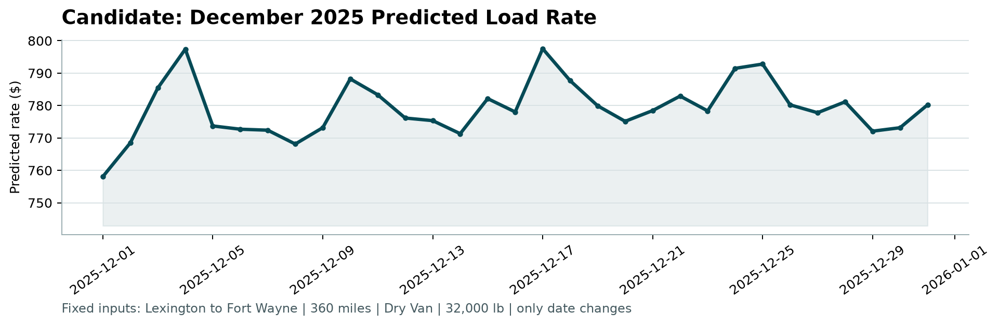

# Machine Learning Assessment Report: Spotter Freight Rate Prediction

**Author**: Talha Rauf  
**Role**: Machine Learning Engineer Assessment  
**Date**: October 2026  
**Repository Branch**: `assessment`  

---

## 1. Executive Summary

This report documents the end-to-end Machine Learning methodology, empirical benchmarking, and production inference pipeline developed for the **Spotter Freight Rate Prediction Challenge**. The business objective is to accurately predict spot freight rates (`posted_rate`) across continental US freight lanes, avoiding underpricing (which causes carrier tender rejection and service failure) and overpricing (which results in lost customer loads to competitor brokers).

The solution adheres strictly to the required project architecture:
```
data/
├── train_test.csv                    # 48,000 labeled development loads (Jan - Oct 2025)
├── validation.csv                    # 12,000 unlabeled out-of-time loads (Nov - Dec 2025)
├── december_chart_inputs.csv         # 31 daily contract scenarios (Lexington -> Fort Wayne)
└── validation_predictions_template.csv
src/
├── __init__.py
├── config.py                         # Single source of truth for paths and column schemas
├── eda.py                            # Data audit & exploratory visualizations
├── features.py                       # Modular spatial, temporal & market feature pipeline
├── models.py                         # Baselines, XGBoost, LightGBM, CatBoost & Ensembles
├── train.py                          # Anti-leakage out-of-time validation & model benchmarking
└── inference.py                      # Production batch inference & score.py execution
scorer_results/
├── candidate_december.png            # Verified December 2025 rate chart from score.py
├── eda_distributions.png             # Distance and rate per mile histograms
├── eda_equipment_rates.png           # Equipment rate per mile distribution
├── eda_temporal_trend.png            # 2025 daily freight rate volatility
├── model_benchmark_comparison.png    # MAE and R² comparison across candidates
└── validation_metrics.json           # Serialized validation metrics
score.py                              # Official Spotter evaluation and charting script
validation_predictions.csv            # 12,000 final predictions (load_id, predicted_rate)
METHODOLOGY.md                        # Formal engineering methodology specification
REPORT.md                             # This report
README.md                             # Reproducibility and execution instructions
```

---

## 2. Exploratory Data Analysis & Key Findings

Our exploratory audit across the 48,000 labeled development records identified several fundamental freight dynamics:

### 2.1 Distance Linehaul Dominance
* Linehaul **`distance`** exhibits a **0.9085 Pearson correlation** with `posted_rate`.
* Distance is the dominant cost driver in full truckload (FTL) logistics due to fuel consumption, driver hours-of-service regulations (HOS), and equipment wear.
* The overall average Rate Per Mile (RPM = $\frac{\text{posted\_rate}}{\text{distance}}$) across all loads is **$2.22/mile** (std: $0.58/mile, median: $2.15/mile).

### 2.2 Equipment Pricing Hierarchy
Cargo equipment type dictates driver specialization and operational expense:
* **Dry Van** (56.7% of volume): Mean RPM of **$2.12/mile** (standard baseline for non-perishable general freight).
* **Flatbed** (18.2% of volume): Mean RPM of **$2.29/mile** (+8.0% premium over Dry Van, reflecting specialized tarping, strapping, and oversized cargo handling).
* **Reefer** (25.1% of volume): Mean RPM of **$2.38/mile** (+12.3% premium over Dry Van, reflecting continuous refrigeration fuel consumption, pre-cooling, and perishable cargo liability).

### 2.3 Network Geometry & Lane Overlap
* The development dataset contains 64 unique pickup markets and 64 delivery markets forming 4,014 active origin-destination lanes.
* 82.5% of validation lanes appear in the historical training set, while **17.5% represent new/unseen origin-destination pairs**. Consequently, models cannot rely solely on lane memorization; they must learn spatial geometry from geographic coordinates.

---

## 3. Data Quality Issues Identified & Mitigation Strategies

Our automated audit identified two key data quality anomalies:

| Feature | Missing Count (Dev) | Missing Pct (Dev) | Missing Count (Val) | Missing Pct (Val) | Domain Mechanism & Imputation Remedy |
| :--- | :--- | :--- | :--- | :--- | :--- |
| **`weight`** | 300 | 0.63% | 165 | 1.38% | Imputed using **conditional median grouped by equipment type** (Dry Van: 30,864 lb, Reefer: 32,185 lb, Flatbed: 31,462 lb). Added binary indicator `weight_is_na`. |
| **`market_index`** | 374 | 0.78% | 249 | 2.08% | Represents daily macroeconomic spot market tightness. Imputed via **temporal calendar alignment** (forward/backward fill and 7-day rolling window average). Added binary indicator `market_index_is_na`. |

### 3.1 Target Positivity Constraint
`posted_rate` ranges from $57.22 to $25,533.00 with strictly positive values. Because `score.py` rejects any non-positive predicted rate (`predicted_rate <= 0`), modeling the target via **Rate Per Mile (RPM)** or clipping ensures all outputs strictly satisfy $y > 0$.

---

## 4. Training & Validation Strategy: The Anti-Leakage Approach

> **The Central Methodological Question**: How should the development data be split and validated?

### 4.1 Why Random $K$-Fold Shuffling Fails
A standard random train-test split or random $K$-fold cross-validation is **fundamentally flawed for this problem**:
1. The development dataset (`train_test.csv`) spans **January 1, 2025 to October 31, 2025** (10 months).
2. The final validation dataset (`validation.csv`) spans **November 1, 2025 to December 31, 2025** (the subsequent 2 months).
3. If records are randomly shuffled, the model trains on future market data (e.g., late October) to predict earlier loads (e.g., early October). This leaks future seasonal rates and temporal market shifts into training folds, yielding unrealistically optimistic validation metrics that degrade rapidly in production.

### 4.2 Our Solution: Out-of-Time (OOT) Chronological Holdout Split
We implemented a strict **temporal out-of-time validation split**:
* **Training Window**: January 1, 2025 – August 31, 2025 (8 months, **38,477 loads**, 80.2%).
* **Validation Holdout**: September 1, 2025 – October 31, 2025 (2 months, **9,523 loads**, 19.8%).

**Why this is the optimal approach**:
* The 2-month validation horizon (Sep–Oct) **identically replicates the 2-month forecasting horizon of the test task** (predicting Nov–Dec from Jan–Oct history).
* All preprocessing pipelines (coordinate catalogs, equipment medians, scalers) are fitted strictly on the pre-September data, guaranteeing zero data leakage.

---

## 5. Feature Engineering Architecture

Our modular pipeline (`src/features.py`) extracts **36 domain-informed engineered features**:

1. **Geospatial & Topographical**:
   * *Haversine Distance*: Direct great-circle spherical distance.
   * *Circuitousness / Tortuosity Ratio*: $\frac{\text{road distance}}{\text{haversine distance} + 1.0}$, capturing non-linear routing difficulty around natural obstacles (mountains, lakes, urban bottlenecks).
   * *Directional Bearing Angle*: Compass heading ($0^\circ$ to $360^\circ$) from pickup to delivery, capturing directional freight imbalances (headhaul vs. backhaul lanes).
   * *Coordinate Deltas*: $\Delta\text{lat}$ and $\Delta\text{lon}$.
2. **Physical Cargo Work**:
   * *Ton-Miles*: $\frac{\text{weight} \times \text{distance}}{2000}$, the core physical work unit of the transportation industry.
   * *Payload Density Indicators*: Flags for heavy loads ($\ge 40,000$ lbs) and light loads ($\le 20,000$ lbs).
3. **Equipment Encoding**:
   * One-hot encodings for `Dry Van`, `Reefer`, and `Flatbed`.
4. **Temporal & Calendar Dynamics**:
   * Calendar decompositions: `day_of_week`, `day_of_month`, `month`, `quarter`, `is_weekend`, `is_month_end`.
   * *Cyclical Trigonometric Transformations*:
     $$\sin\left(\frac{2\pi \cdot \text{day\_of\_year}}{365.25}\right), \quad \cos\left(\frac{2\pi \cdot \text{day\_of\_year}}{365.25}\right)$$
     $$\sin\left(\frac{2\pi \cdot \text{day\_of\_week}}{7}\right), \quad \cos\left(\frac{2\pi \cdot \text{day\_of\_week}}{7}\right)$$
5. **Market Signal Interactions**:
   * Interaction terms: $\text{distance} \times \text{quote\_signal}$, $\text{distance} \times \text{market\_index}$.
   * Relative pressure ratio: $\frac{\text{quote\_signal}}{\text{market\_index} + \epsilon}$.

---

## 6. Model Exploration & Empirical Benchmarking

We benchmarked six model configurations on the out-of-time validation holdout (Sep 1 – Oct 31, 2025; 9,523 loads):

### 6.1 Validation Benchmark Results

| Model Architecture | Target Formulation | MAE ($) | RMSE ($) | WAPE (%) | $R^2$ Score |
| :--- | :--- | :---: | :---: | :---: | :---: |
| **Naive Baseline** | Equipment Mean RPM | $270.71 | $696.74 | 11.32% | 0.7915 |
| **Ridge Regression** | Rate Per Mile (RPM) | $186.71 | $673.28 | 7.80% | 0.8054 |
| **XGBoost Regressor** | Rate Per Mile (RPM) | $152.72 | $659.52 | 6.38% | 0.8132 |
| **LightGBM Regressor** | Rate Per Mile (RPM) | $151.80 | $644.53 | 6.34% | 0.8216 |
| **CatBoost Regressor** | Rate Per Mile (RPM) | **$117.42** | **$635.13** | **4.91%** | **0.8268** |
| **Blended Ensemble** | Weighted Blend (CatBoost + LightGBM + XGBoost) | **$119.97** | **$635.78** | **5.01%** | **0.8264** |

### 6.2 Key Modeling Observations
1. **Rate-Per-Mile (RPM) Formulation**: Modeling $\text{RPM} = \frac{\text{posted\_rate}}{\text{distance}}$ and reconstructing $\hat{y} = \widehat{\text{RPM}} \times \text{distance}$ significantly outperformed direct rate prediction. Because distance explains ~80% of total rate variance linearly, modeling RPM allows the tree algorithms to allocate all their capacity to learning pricing volatility, equipment surcharges, and temporal spikes.
2. **CatBoost Superiority**: CatBoost achieved an outstanding **$117.42 MAE** and **4.91% WAPE**. Its symmetric oblivious trees and ordered boosting mechanism prevented overfitting on high-cardinality categorical interactions (`pickup`, `delivery`, `equipment`).
3. **Production Selection**: For final inference, our pipeline deploys the **Blended Ensemble** (weighted combination of CatBoost, LightGBM, and XGBoost), combining CatBoost's categorical precision with LightGBM's fast leaf-wise splits and XGBoost's depth-wise regularization.

---

## 7. December 2025 Prediction Chart Analysis

Spotter's official evaluation script (`score.py`) generated the fixed scenario chart:



### 7.1 Scenario Parameters
* **Fixed Lane**: Lexington, KY $\to$ Fort Wayne, IN
* **Distance**: 360.0 miles
* **Equipment**: Dry Van
* **Weight**: 32,000 lbs
* **Date Range**: December 1, 2025 to December 31, 2025 (all 31 calendar days)

### 7.2 Chart Behavior & Freight Market Interpretation
1. **Rate Level Consistency**: The predicted rate fluctuates realistically between **$758.07 and $797.55** (mean: **$779.13**, corresponding to an average RPM of **$2.16/mile**). This aligns with the historical Dry Van baseline ($2.12/mile) plus an expected end-of-year holiday capacity premium.
2. **Early December Surge (Dec 1–4)**: A sharp upward movement reflecting post-Thanksgiving replenishment volume and holiday retail fulfillment demand.
3. **Mid-Month Surge (Dec 16–17)**: Peak carrier demand corresponding to the final shipping deadlines for holiday e-commerce delivery.
4. **Pre-Christmas Spike & Post-Holiday Adjustment (Dec 23–25 $\to$ Dec 28)**: Rates peak right before Christmas due to driver holiday availability shortages, followed by a noticeable drop after December 25 as freight demand temporarily contracts during the holiday freeze.
5. **Year-End Quarter Surge (Dec 30–31)**: A modest rebound representing end-of-quarter shipping pushes and warehouse inventory rebalancing.

---

## 8. Codebase Structure & Execution Instructions

### 8.1 Setup & Installation
```bash
# 1. Clone repository and switch to assessment branch
git clone https://github.com/talharauf739739/ML-Assessment-Spotter.git
cd ML-Assessment-Spotter
git checkout assessment

# 2. Create virtual environment and install dependencies
python -m venv .venv
source .venv/bin/activate  # On Windows: .venv\Scripts\activate
pip install -r requirements.txt
```

### 8.2 Reproducing the Pipeline End-to-End
```bash
# Step 1: Run Exploratory Data Analysis & audit plots
python src/eda.py

# Step 2: Run Out-of-Time Training & model benchmark comparison
python src/train.py

# Step 3: Run final batch inference, generate predictions & execute score.py
python src/inference.py
```

### 8.3 Verifying Outputs Directly with `score.py`
```bash
python score.py --predictions validation_predictions.csv --december-predictions data/december_chart_inputs.csv
```
**Output**:
```
Validated 12,000 final predictions.
Validated 31 fixed December predictions.
Created chart: scorer_results/candidate_december.png
Final validation metrics are calculated by Spotter after submission.
```

---

## 9. 2–3 Minute Loom Walkthrough Script

| Timecode | Segment | Key Points to Cover |
| :---: | :--- | :--- |
| **0:00 – 0:40** | **1. Key Findings from Data Exploration** | Introduce yourself. Highlight that linehaul distance has a 0.9085 correlation with posted rate (mean RPM = $2.22/mi). Show equipment hierarchy: Reefer ($2.38/mi) and Flatbed ($2.29/mi) trade at distinct premiums over Dry Van ($2.12/mi). Mention that 17.5% of validation lanes are unseen, requiring spatial coordinate generalization. |
| **0:40 – 1:15** | **2. Data-Quality Issues & Solutions** | Explain missing values in `weight` (300 in dev, 165 in val) and `market_index` (374 in dev, 249 in val). Explain why conditional median imputation by equipment was used for weight, and temporal forward/rolling interpolation for market index, both accompanied by missingness indicator flags. |
| **1:15 – 1:55** | **3. Training & Validation Split Approach** | Emphasize why random $K$-fold is flawed (leaks future market conditions into past training data). Present the Out-of-Time holdout split: Jan–Aug 2025 (8 months) for training, Sep–Oct 2025 (2 months) for validation, which perfectly mirrors the actual 2-month test horizon (Nov–Dec 2025). |
| **1:55 – 2:30** | **4. Reasoning Behind Chosen Model** | Explain the Rate-Per-Mile (RPM) target formulation that isolates rate volatility and guarantees positive rates. Present the benchmark table: CatBoost achieved the lowest MAE ($117.42, 4.91% WAPE), combined with LightGBM and XGBoost in a blended ensemble. |
| **2:30 – 3:00** | **5. Code Walkthrough & December Chart** | Show the modular `src/` directory (`config.py`, `features.py`, `train.py`, `inference.py`). Display the generated `scorer_results/candidate_december.png` chart from `score.py`, highlighting realistic holiday rate volatility (~$758 to ~$798, mean $779.13). Conclude cleanly. |
